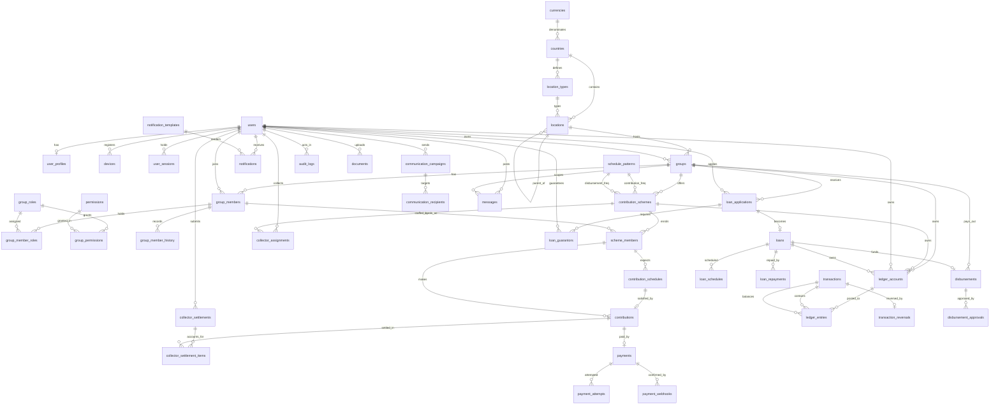

# 03 — Database Design

**Status:** Phase 0 draft, awaiting review
**Derives from:** 01_PRODUCT_REQUIREMENTS, 02_SYSTEM_ARCHITECTURE, Master Development Prompt §3–§17, §25, §27, §28, §43
**Depends on:** 01, 02
**Decisions applied:** Q1 (design for both custody models), Q7 (integer minor units), Q9 (double-entry)

---

## 1. Principles

| # | Principle | Consequence |
|---|---|---|
| D1 | **PostgreSQL is the only source of truth for money.** | No balance, total, or financial figure lives in Redis or in application memory beyond a request. |
| D2 | **The ledger is append-only.** | `ledger_entries` and `transactions` admit INSERT and nothing else. No UPDATE, no DELETE — enforced by the database, not by convention. |
| D3 | **Money is an integer count of minor units.** | `BIGINT`, never `FLOAT`/`DOUBLE`/`REAL`. ₦1,000.00 is `100000`. |
| D4 | **Balances are derived.** | Where a balance is cached for speed, it is marked derived, is recomputable, and is reconciled against the ledger on a schedule. |
| D5 | **Every financial mutation is idempotent.** | Every table that records money carries a unique `idempotency_key`. |
| D6 | **Internal keys are integers; external keys are UUIDs.** | `BIGINT` identity primary keys for index density and FK size; a unique `public_id UUID` is what leaves the API. |
| D7 | **Nothing financial is deleted.** | Status columns retire rows. `ON DELETE RESTRICT` is the default for financial FKs. |
| D8 | **The schema must not hard-code one country's geography.** | One generic `locations` tree, typed per country. |

### 1.1 On D6 — why two keys

A sequential integer primary key is the right index for a table with hundreds of
millions of ledger rows: it is dense, it clusters inserts at the end of the B-tree, and
foreign keys are 8 bytes rather than 16. A UUID primary key makes every insert land on
a random page, and that cost compounds in exactly the tables that grow fastest here.

But a sequential integer in a URL is enumerable — `/api/v1/contributions/1842` invites
`1843`. So integers never leave the process. Every externally visible entity also
carries `public_id UUID NOT NULL UNIQUE DEFAULT gen_random_uuid()`, and the API resolves
by that. Internal FKs continue to use the integer.

### 1.2 On D3 — the money type

Every monetary column is `BIGINT` holding minor units. A shared `Money` value object
wraps `(amount_minor: int, currency: str)` in application code.

`NUMERIC(20,4)` was considered and rejected. It is exact and it is the conventional
choice, but it defers the rounding question to every call site rather than answering it
once, and it makes "what precision is this in?" a thing a developer must look up per
column. Integers make the unit unambiguous at the storage layer. Where division is
unavoidable — allocating interest, splitting a fee — the rounding rule and the
treatment of the remainder are specified in 06_FINANCIAL_RULES and implemented once in
the `Money` type, not re-decided per feature.

Currency minor units vary by currency (NGN 2, JPY 0, KWD 3), and so does the rounding
mode. Both live on `currencies`, not on `countries`, so a currency shared by several
countries has exactly one definition (06 §3.4). Formatting and parsing derive from it
rather than assuming 2.

---

## 2. The ledger

This is the load-bearing structure. Everything else in the schema is, in an important
sense, context for it.

### 2.1 Model

Double-entry (Q9). Every financial event creates one `transactions` row and **two or
more** `ledger_entries` rows that sum to zero. No money moves without both halves being
written in the same database transaction.

```
transactions (the journal header)
   │  1:N
   ▼
ledger_entries (the lines — these are what make the books balance)
   │  N:1
   ▼
ledger_accounts (the chart of accounts)
```

### 2.2 `ledger_accounts`

The chart of accounts. An account is a *place money can sit*, scoped to whatever owns it.

| Column | Type | Notes |
|---|---|---|
| `id` | BIGINT PK | |
| `public_id` | UUID UNIQUE | |
| `code` | VARCHAR(32) | Hierarchical, e.g. `1000`, `1000.001`. Unique within scope. |
| `name` | VARCHAR(255) | |
| `account_type` | VARCHAR(16) | `ASSET`, `LIABILITY`, `EQUITY`, `INCOME`, `EXPENSE` |
| `normal_balance` | VARCHAR(6) | `DEBIT` or `CREDIT` |
| `owner_type` | VARCHAR(24) | `PLATFORM`, `GROUP`, `SCHEME`, `MEMBER`, `LOAN`, `EXTERNAL` |
| `platform_id` | BIGINT FK NULL | Exactly one owner FK is non-null — see §2.2.1 |
| `group_id` | BIGINT FK NULL | |
| `scheme_id` | BIGINT FK NULL | |
| `member_id` | BIGINT FK NULL | |
| `loan_id` | BIGINT FK NULL | |
| `currency` | CHAR(3) | |
| `parent_id` | BIGINT FK NULL | Self-reference, builds the tree |
| `is_custody_account` | BOOLEAN DEFAULT FALSE | See §2.6 |
| `is_active` | BOOLEAN DEFAULT TRUE | Closed accounts are deactivated, never deleted |
| `created_at` | TIMESTAMPTZ | |

**Indexes:** `UNIQUE (code, owner_type, group_id, scheme_id, member_id, loan_id)` —
`NULLS NOT DISTINCT` (PostgreSQL 15+) so that two platform-level accounts with the same
code cannot both exist despite their null owner FKs. Plus `(owner_type, group_id)`,
`(scheme_id)`, `(member_id)`, `(currency)`.

**Constraint `ck_account_exactly_one_owner`:**

```sql
CHECK (
  (owner_type = 'PLATFORM' AND platform_id IS NOT NULL AND group_id IS NULL
     AND scheme_id IS NULL AND member_id IS NULL AND loan_id IS NULL)
  OR (owner_type = 'GROUP'  AND group_id  IS NOT NULL AND platform_id IS NULL
     AND scheme_id IS NULL AND member_id IS NULL AND loan_id IS NULL)
  OR (owner_type = 'SCHEME' AND scheme_id IS NOT NULL AND platform_id IS NULL
     AND group_id IS NULL AND member_id IS NULL AND loan_id IS NULL)
  OR (owner_type = 'MEMBER' AND member_id IS NOT NULL AND platform_id IS NULL
     AND group_id IS NULL AND scheme_id IS NULL AND loan_id IS NULL)
  OR (owner_type = 'LOAN'   AND loan_id   IS NOT NULL AND platform_id IS NULL
     AND group_id IS NULL AND scheme_id IS NULL AND member_id IS NULL)
  OR (owner_type = 'EXTERNAL' AND platform_id IS NULL AND group_id IS NULL
     AND scheme_id IS NULL AND member_id IS NULL AND loan_id IS NULL)
)
```

#### 2.2.1 Why six nullable FKs and not a generic `(owner_type, owner_id)`

A polymorphic `owner_id` cannot carry a foreign key, so PostgreSQL cannot guarantee
that a `MEMBER` account points at a member who exists. In a ledger, an entry pointing
at an account pointing at nothing is unrecoverable data corruption — the orphaned
entry has no owner to reconcile against. Six nullable columns with a `CHECK` cost a few
bytes per row and buy real referential integrity across all six scopes. For a chart of
accounts, which is small and slow-growing, that trade is not close.

### 2.3 `transactions`

The journal header. One row per financial event.

| Column | Type | Notes |
|---|---|---|
| `id` | BIGINT PK | |
| `public_id` | UUID UNIQUE | |
| `reference` | VARCHAR(64) UNIQUE | Human-readable, e.g. `CON-20260915-1842` (§43) |
| `transaction_type` | VARCHAR(32) | `CONTRIBUTION`, `LOAN_DISBURSEMENT`, `LOAN_REPAYMENT`, `GROUP_DISBURSEMENT`, `REFUND`, `FEE`, `REVERSAL`, `ADJUSTMENT` (§12) |
| `status` | VARCHAR(16) | `POSTED`, `REVERSED` |
| `idempotency_key` | VARCHAR(128) UNIQUE | D5 |
| `group_id` | BIGINT FK NULL | Context |
| `scheme_id` | BIGINT FK NULL | Context |
| `initiated_by_id` | BIGINT FK NULL | NULL for system-initiated (e.g. scheduled interest accrual) |
| `description` | TEXT | |
| `metadata` | JSONB | Type-specific context; never the authoritative amount |
| `occurred_at` | TIMESTAMPTZ | When the money moved in the real world |
| `posted_at` | TIMESTAMPTZ | When the system recorded it |
| `reverses_transaction_id` | BIGINT FK NULL UNIQUE | Set when this row *is* a reversal |
| `currency` | CHAR(3) | |

**Indexes:** `(group_id, occurred_at DESC)`, `(scheme_id, occurred_at DESC)`,
`(transaction_type, occurred_at DESC)`, `(status)`.

**`occurred_at` vs `posted_at` is not redundant.** A collector recording Thursday's
cash on Friday produces a transaction where those differ, and a reconciliation report
that conflates them will show the wrong day's takings. §11 requires both date and time
on a contribution; this is where that requirement is honoured.

### 2.4 `ledger_entries`

The lines. **This is the only table whose arithmetic defines truth.**

| Column | Type | Notes |
|---|---|---|
| `id` | BIGINT PK | |
| `transaction_id` | BIGINT FK NOT NULL | `ON DELETE RESTRICT` |
| `account_id` | BIGINT FK NOT NULL | `ON DELETE RESTRICT` |
| `direction` | VARCHAR(6) | `DEBIT` or `CREDIT` |
| `amount` | BIGINT NOT NULL | Always **positive**; direction carries the sign |
| `currency` | CHAR(3) | Must equal the transaction's |
| `memo` | VARCHAR(255) | |
| `created_at` | TIMESTAMPTZ | |

**Constraints:**
- `CHECK (amount > 0)` — a zero-amount entry is a bug, and a negative amount means
  someone used the sign instead of the direction. Rejecting both at the database makes
  the invariant un-forceable from application code.
- `CHECK (direction IN ('DEBIT','CREDIT'))`
- `UNIQUE (transaction_id, account_id, direction)` is deliberately **not** applied —
  a legitimate transaction can post twice to the same account in the same direction
  (e.g. two fee lines). Reversal is by entry, not by assumption.

#### 2.4.1 The balance invariant, and how it is enforced

```
For every transaction: SUM(DEBIT amounts) = SUM(CREDIT amounts)
```

Application code enforces this in `ledger.services.post_transaction()` — the single
function every module calls to move money, and the only writer to these tables.

Application code alone is not enough. §44's rules are the kind that get violated by a
data migration at 2am, so the invariant is also enforced in the database by a
`CONSTRAINT TRIGGER` on `ledger_entries`, `DEFERRABLE INITIALLY DEFERRED`:

```sql
CREATE CONSTRAINT TRIGGER trg_entries_balance
AFTER INSERT ON ledger_entries
DEFERRABLE INITIALLY DEFERRED
FOR EACH ROW EXECUTE FUNCTION assert_transaction_balances();
```

`DEFERRABLE INITIALLY DEFERRED` is essential and not a detail: entries for one
transaction are inserted one at a time, so the sum is transiently unbalanced mid-insert.
Checking at `COMMIT` rather than per-row means the constraint can only ever see complete
transactions, and an unbalanced one fails the commit rather than being cleaned up later.

The same trigger rejects entries against a transaction whose status is `REVERSED`, and
entries that mix currencies within a transaction.

### 2.5 `transaction_reversals`

§12: *"Never simply delete a completed financial transaction... create a reversal or
correcting transaction."* §27 names this entity.

| Column | Type | Notes |
|---|---|---|
| `id` | BIGINT PK | |
| `original_transaction_id` | BIGINT FK NOT NULL UNIQUE | |
| `reversal_transaction_id` | BIGINT FK NOT NULL UNIQUE | The new, offsetting transaction |
| `reason` | TEXT NOT NULL | Required. A reversal without a stated reason is not reviewable. |
| `requested_by_id` | BIGINT FK | |
| `approved_by_id` | BIGINT FK NULL | Where the reversal exceeds the requester's authority |
| `created_at` | TIMESTAMPTZ | |

The `UNIQUE` on `original_transaction_id` means **a transaction can be reversed at most
once.** Reversing a reversal is how you "un-reverse" — that is a new transaction with
its own audit trail, and it keeps the chain linear and auditable rather than tangled.

`reversal_transaction_id` is itself a `transactions` row of type `REVERSAL` whose
entries are the exact mirror of the original's. It is never a deletion, and the original
row is never touched.

### 2.6 Custody flexibility (Q1)

**Decision: support both models in the schema; select one by configuration.**

The platform operates under exactly one custody model at a time, recorded in
`platform_settings.custody_model`:

| Value | Meaning |
|---|---|
| `SYSTEM_OF_RECORD` | The platform records money it never holds. Money moves member → collector → the group's own account at a licensed institution. **The working default.** |
| `PLATFORM_CUSTODY` | Money is held in pooled/virtual accounts with a licensed partner, and the platform instructs payouts. |

The difference in the schema is narrow and deliberately confined to one place: whether
accounts with `is_custody_account = TRUE` and `owner_type = 'PLATFORM'` may exist.

Under `SYSTEM_OF_RECORD` — the mode all current documents assume — the chart of
accounts contains **no platform custody account**, and the ledger's `EXTERNAL` accounts
represent money in transit (cash held by a collector, funds clearing at a provider)
rather than money the platform owns.

The flexibility is enforced rather than assumed. `ledger.services.create_account()`
rejects `is_custody_account = TRUE` unless the platform is in `PLATFORM_CUSTODY` mode,
and a database `CHECK` on `ledger_accounts` backs it:

```sql
CHECK (NOT is_custody_account OR owner_type = 'PLATFORM')
```

Switching modes is therefore a configuration change plus the creation of a custody
account subtree — **not** a migration of existing entries. That is the entire point of
deciding this now: the ledger's shape does not change when the legal answer arrives.
The regulatory work that switching *does* require is tracked in 14_REGULATORY_CHECKLIST,
and §45 requires the legal review regardless of which mode is chosen.

**This is not a licence to defer indefinitely.** Custody was left open because it is a
legal question with a legal answer, not an engineering preference. It is revisited
before Phase 3, which is where real money first moves.

---

## 3. Chart of accounts (seed)

Under the default `SYSTEM_OF_RECORD` mode. Codes follow normal accounting convention:
1xxx assets, 2xxx liabilities, 3xxx equity, 4xxx income, 5xxx expenses.

| Code | Name | Type | Normal | Owner | Purpose |
|---|---|---|---|---|---|
| `1000` | Cash in Transit — Collector | ASSET | DEBIT | EXTERNAL | Cash physically held by a collector, pre-settlement |
| `1010` | Funds Clearing — Provider | ASSET | DEBIT | EXTERNAL | Confirmed at provider, not yet settled to group |
| `1100` | Group Pool | ASSET | DEBIT | GROUP | Funds held for a group |
| `1110` | Scheme Pool | ASSET | DEBIT | SCHEME | Funds held for a scheme |
| `1200` | Loan Receivable | ASSET | DEBIT | LOAN | Outstanding principal owed on a loan |
| `1210` | Interest Receivable | ASSET | DEBIT | LOAN | Accrued, unpaid interest |
| `1220` | Fees Receivable | ASSET | DEBIT | LOAN | Accrued, unpaid fees |
| `2000` | Member Contribution Balance | LIABILITY | CREDIT | MEMBER | What the group owes the member |
| `2010` | Member Savings Balance | LIABILITY | CREDIT | MEMBER | |
| `2100` | Settlement Variance Suspense | LIABILITY | CREDIT | GROUP | Holds an unexplained shortfall or surplus (§10) |
| `4000` | Late Fee Income | INCOME | CREDIT | GROUP / PLATFORM | Destination open — PRD Q4 |
| `4010` | Interest Income | INCOME | CREDIT | GROUP | |
| `4020` | Platform Fee Income | INCOME | CREDIT | PLATFORM | |
| `5000` | Loan Write-off | EXPENSE | DEBIT | PLATFORM | |
| `5010` | Disbursement Expense | EXPENSE | DEBIT | GROUP | |

Two design notes:

**`2100 Settlement Variance Suspense` exists because §10 says a variance must never be
silently altered.** When a collector submits ₦76,000 against ₦82,000 expected, the
₦6,000 does not vanish and is not quietly written off. It sits in a suspense account
until the explanation is recorded and someone with authority resolves it. A suspense
account is the accounting mechanism for "known to be wrong, not yet resolved" — which
is precisely the state §10 describes, and precisely the state that gets smeared over
when there is nowhere to put it.

**`4000 Late Fee Income` has two candidate owners and the document does not choose.**
PRD Q4 is open. The account exists; who it belongs to is a business decision, and it is
left visibly unresolved rather than defaulted.

---

## 4. Foundation tables (L0)

### 4.1 `users` (custom Django user — §4)

| Column | Type | Notes |
|---|---|---|
| `id` | BIGINT PK | |
| `public_id` | UUID UNIQUE | |
| `full_name` | VARCHAR(255) | |
| `username` | VARCHAR(150) UNIQUE NULL | "where appropriate" (§4) — nullable |
| `email` | CITEXT UNIQUE NULL | `CITEXT` so `A@x.com` and `a@x.com` cannot both register |
| `phone` | VARCHAR(20) UNIQUE | E.164 normalised. The primary login identifier. |
| `password` | VARCHAR(128) | Django hasher output |
| `pin_hash` | VARCHAR(128) NULL | Hashed to the same standard as the password (FR-AUTH-005) |
| `account_status` | VARCHAR(16) | `ACTIVE`, `SUSPENDED`, `CLOSED` |
| `verification_status` | VARCHAR(16) | Tracked separately from account status (FR-AUTH-014) |
| `is_email_verified` | BOOLEAN | |
| `is_phone_verified` | BOOLEAN | |
| `two_factor_enabled` | BOOLEAN | |
| `two_factor_method` | VARCHAR(16) NULL | |
| `totp_secret` | TEXT | Fernet-encrypted shared seed; empty until confirmed or for SMS |
| `mfa_version` | INTEGER | Starts at 0; increments on enable/disable; invalidates bearer and browser sessions |
| `last_totp_step` | BIGINT | Last consumed 30-second step; -1 before use; prevents TOTP replay |
| `failed_login_attempts` | SMALLINT | |
| `locked_until` | TIMESTAMPTZ NULL | Account lockout (NFR-SEC-002) |
| `is_staff`, `is_superuser` | BOOLEAN | Django admin plumbing |
| `date_registered` | TIMESTAMPTZ | |
| `last_login` | TIMESTAMPTZ NULL | |
| `date_joined` | TIMESTAMPTZ | Django requirement |

**`phone` is `UNIQUE` and non-nullable; `email` is nullable.** In the target market the
phone is the durable identity — it is what a member has, what OTPs reach, and what a
collector can verify in person. Email is optional in §4 and treated as such.

### 4.2 `user_profiles`

Split from `users` per §27, keeping the authentication table narrow and the descriptive
data (which changes more often and is read less often) separate.

`id`, `user_id` (FK UNIQUE), `profile_picture`, `address_line`, `location_id`
(FK → `locations`, §5.2.1), `date_of_birth`, `gender`, `occupation`,
`next_of_kin_name`, `next_of_kin_phone`, `kyc_level`, `created_at`, `updated_at`.

One `location_id`, for the same reason `groups` has one (§5.2.1). An address is a place;
its state and LGA are reachable by walking the tree rather than stored as columns that
can contradict each other.

### 4.3 `devices` and `user_sessions`

`devices` (§4, §27): `id`, `public_id` UUID UNIQUE, `user_id`, `device_fingerprint`, `platform`, `model`,
`os_version`, `app_version`, `push_token`, `last_seen_at`, `is_revoked`, `created_at`.
`UNIQUE (user_id, device_fingerprint)`.

`user_sessions` (§4 session management): `id`, `public_id`, `user_id`, `device_id` NULL,
`family_id` UUID, `refresh_token_hash`, `issued_at`, `expires_at`, `revoked_at`, `revoked_reason`, `ip_address`,
`user_agent`, `last_used_at`.

`mfa_verified` records successful second-factor proof; `mfa_version` binds the
session to the user's factor configuration. Rotation inherits both. Migration
`0004_mfa` defaults legacy sessions to unverified; it never invents MFA proof.

`0005_browser_mfa` adds `kind` (`TOKEN` or `BROWSER`),
`browser_session_key_hash` and `browser_credential_state`. Browser rows require
MFA verification and nonempty browser digests; token rows require empty digests.
Browser rows bind the server-side Django cookie to its WEB device and original
absolute deadline. Their random refresh placeholder is never delivered or
accepted by the refresh service. Legacy rows default to `TOKEN`.
`mfa_challenges.audience` distinguishes token and browser proofs; only browser
proofs have a nonempty `browser_session_key_hash`.

Refresh tokens are stored **hashed**, for the same reason passwords are: a leaked
session table should not be a set of usable credentials. Rotation with reuse detection
is specified in 10_SECURITY_REQUIREMENTS.

### 4.4 `otp_codes` and `verification_tokens`

`otp_codes`: `id`, `user_id` NULL, `destination` (phone/email), `purpose`, `code_hash`,
`attempts`, `max_attempts`, `expires_at`, `consumed_at`, `created_at`.
Indexed on `(destination, purpose, expires_at)`.

`verification_tokens`: `id`, `user_id`, `purpose` (`EMAIL_VERIFY`, `PHONE_VERIFY`,
`PASSWORD_RESET`), `token_hash`, `expires_at`, `consumed_at`, `created_at`.

Both store hashes, both are single-use (`consumed_at`), both expire (FR-AUTH-006/008/009).

Email verification uses the existing token table, with a 24-hour expiry and a
digest bound to the saved email and current password/PIN/MFA version. Resend
consumes earlier email verification tokens. Confirmation consumes the proof and
updates the email ownership fact atomically under the user lock. The channel
booleans are the facts; `verification_status` summarizes them as `UNVERIFIED`,
`PHONE_VERIFIED`, `EMAIL_VERIFIED` or `FULLY_VERIFIED`. Both confirmation orders
produce the same summary. Email verification needs no additional schema migration.

### 4.4.1 MFA enrollment, recovery and challenges

`mfa_enrollments`: `id`, `user_id` UNIQUE, `method`, `secret` (encrypted TOTP seed),
`code_hash` (SMS), `credential_state`, `expires_at`, `attempts`. Pending setup expires
after 10 minutes, permits three guesses, and changes no active factor until confirmed.

`mfa_recovery_codes`: `id`, `user_id`, `code_hash` UNIQUE, `consumed_at`. Ten 80-bit
random codes are returned once after confirmation. Domain-separated SHA-256
digests persist; each code is consumed under the user lock.

`mfa_challenges`: `id`, `user_id`, `device_id`, `token_hash` UNIQUE,
`credential_state`, `enrollment_required`, `audience`, `browser_session_key_hash`, `code_hash` (SMS), `expires_at`,
`attempts`, `consumed_at`. Opaque 384-bit password proofs expire after five minutes,
permit three guesses, and bind credentials, factor configuration, current role
flags and verified phone state. Device ownership and revocation are checked on use.
Fresh password login supersedes previous challenges. Enrollment-only proofs grant
access solely to MFA setup/confirmation and never authorize other API routes.

### 4.5 Location tables (§3)

**This is where the "generic, not welded to one country" decision lands.**

`currencies`: `code` CHAR(3) PK, `numeric_code` CHAR(3) NULL, `name`,
`minor_units` SMALLINT, `rounding_mode` (enum, 06 §3.4.1), `cash_rounding_increment`
BIGINT NULL, `symbol`, `is_active`, timestamps.

Seeds: **NGN** (2, `HALF_UP`) for launch, plus **JPY** (0), **KWD** (3), **USD**, **GBP**,
**EUR**, **GHS**, **KES**, **ZAR**, **XOF**, **XAF** as inactive rows. Seeding the
awkward exponents at the start is deliberate: a 0-exponent and a 3-exponent currency
present from the first migration mean every test and every code path meets them before a
market depends on them, rather than discovering the assumption in production.

`countries`: `id`, `iso2` UNIQUE, `iso3` UNIQUE, `name`, `dial_code`,
`currency_code` FK → `currencies`, `default_locale`, `is_active`, timestamps.

`location_types`: `id`, `country_id`, `code`, `name_singular`, `name_plural`, `level`
(SMALLINT), `is_leaf` (BOOLEAN). `UNIQUE (country_id, code)`, `UNIQUE (country_id, level)`.

Nigeria seeds:

| level | code | singular | plural |
|---|---|---|---|
| 1 | `STATE` | State | States |
| 2 | `LGA` | LGA | LGAs |
| 3 | `CITY` | City/Town | Cities/Towns |
| 4 | `AREA` | Area | Areas |
| 5 | `STREET` | Street | Streets |

A country without LGAs simply seeds four levels. A country with an extra tier seeds six.
**No code changes; only rows.**

`locations`: `id`, `public_id`, `country_id`, `location_type_id`, `parent_id` (self FK
NULL), `name`, `slug`, `code` NULL, `latitude` NULL, `longitude` NULL, `is_active`,
timestamps.

- `UNIQUE (parent_id, location_type_id, slug)` — `NULLS NOT DISTINCT`, so two root
  states cannot share a slug.
- `CHECK (parent_id IS NULL) = (level = 1)` enforced via a trigger, since the level
  lives on `location_types`.
- Indexes: `(location_type_id, parent_id, name)`, `(parent_id)`, `(country_id, is_active)`,
  and a trigram index on `name` for search (FR-LOC-003).

#### 4.5.1 Reconciling §27 with the generic model

§27 lists `states`, `lgas`, `cities`, `areas`, `streets` as core entities. The generic
decision says one typed tree. Both are satisfied:

```sql
CREATE VIEW states AS SELECT * FROM locations
  WHERE location_type_id = (SELECT id FROM location_types WHERE code='STATE' AND ...);
```

These are **read-only convenience views**, one per seeded type, giving §27's entities
their names for querying and reporting. All writes go through `locations`, so there is
no dual-write and no drift. The views are generated per country at seed time.

This is a deliberate reading of §27 rather than a literal implementation of it. Six
near-identical tables would hard-code Nigeria's administrative vocabulary into the
schema — which the generic-schema decision exists to prevent — and would turn adding a
country into a migration.

#### 4.5.2 Why currency is its own table

Currency attributes used to sit on `countries`, which was wrong for a platform whose
horizon is not one country.

**Currencies are shared; countries are not.** XOF is legal tender in eight West African
states, XAF in six, EUR in twenty. Storing `minor_units` per country means the same
currency can be configured as 2 in one row and 0 in another, and the platform then has
two answers to "how many decimal places does this have?" — with no tiebreak. The ledger
would be internally inconsistent in a way no constraint could catch, because both rows
are individually valid.

One currency, one definition. `countries.currency_code` is a foreign key, so the
inconsistency is not merely discouraged — it is unrepresentable.

**Rounding is a property of the currency, not the country.** 06 §3.4 makes the rounding
mode data. It belongs beside `minor_units` for the same reason: they are two facts about
the same thing, and separating them lets one drift from the other.

`cash_rounding_increment` is nullable and defaults to NULL, meaning "no cash rounding".
Where a country has eliminated its smallest coin — CAD's penny, SEK's öre — cash
transactions round to the nearest increment (typically 5 minor units) while electronic
ones do not. Modelled as a currency attribute rather than a payment-method branch,
because it applies to whatever method handles physical cash.

**`numeric_code`** is ISO 4217's numeric form, used by some banking and settlement
formats. Stored because a provider integration will eventually need it, and adding a
column later is a migration against a table every financial record references.

---

## 5. Groups and roles (L1)

S5 adds `role_templates` (immutable scope and policy JSON), `role_sets` and their
template bindings, `platform_role_assignments` (separate from group memberships)
and a singleton `platform_permission_state`. Group and membership external IDs
are UUIDs. `groups.permission_version` and `users.authorization_version` support
immediate cache/session invalidation; `users.role_mfa_required` is derived by
database triggers. Each `user_sessions` row records its authorization version.
The additive account migration preserves legacy zero-version sessions.

Roles bind to a frozen template. Grants have a `changed_by_id` actor;
memberships have `status_changed_by_id`. Database triggers enforce role scope,
required/forbidden grant bounds, assignment authority, initial bootstrap limits,
owner/last-platform-admin preservation and immutable membership history.
Invitation secrets are returned once and stored only as digests, with target,
expiry and single-decision constraints. See [GROUPS.md](GROUPS.md) for lifecycle
rules and [05_ROLE_PERMISSION_MATRIX.md](05_ROLE_PERMISSION_MATRIX.md) for the seed.

### 5.1 `group_types`
`id`, `code` UNIQUE, `name`, `description`, `is_system`, `default_role_set_id` NULL.
Seeds: `DAILY_CONTRIBUTION`, `MONTHLY_SAVINGS`, `COOPERATIVE`, `ASSOCIATION`,
`WELFARE`, `TRADERS`.

### 5.2 `groups` (§6)
`id`, `public_id`, `name`, `description`, `logo`, `group_type_id`, `location_id`
(FK → `locations`), `owner_id` (FK users),
`status` (`DRAFT`, `ACTIVE`, `SUSPENDED`, `CLOSED`, `ARCHIVED`), `rules` TEXT,
`membership_mode` (`INVITE_ONLY`, `APPLICATION`, `OPEN`),
`requires_membership_approval` BOOLEAN, `created_by_id`, timestamps.

Indexes: `(location_id, status)` — the query behind "what groups are on this street"
(FR-LOC-004) — `(owner_id)`, `(group_type_id)`, trigram on `name`.

#### 5.2.1 One location FK, not five

An earlier draft carried `country_id`, `state_id`, `lga_id`, `city_id`, `area_id`,
`street_id` — six columns derived from §3's hierarchy. That was wrong twice over.

**It welds the table to one country's vocabulary.** A country with four administrative
levels, or six, has no correct value for those columns. Adding a country becomes a
migration, which is the outcome the generic-location decision exists to prevent — and it
would have re-introduced in `groups` exactly what §4.5 removed from the location model.

**It admits contradictory rows.** Six independent FKs can point at a city in one state
and an LGA in another. Nothing in the schema forbids it, and the resulting group has no
well-defined place.

A single `location_id` names the node the group sits at — usually a street, but an area,
a city, or a country root for a national association. Everything above it is derived by
walking `locations.parent_id`, so a group's state is a query rather than a column that
can disagree with its street.

`country_id` is reachable the same way, but is **denormalised into an index** rather than
a second column: `(location_id, status)` covers the street query, and a partial index on
the resolved country is added only if reporting demonstrates the need.

### 5.3 `group_members` (§6)
`id`, `public_id`, `group_id`, `user_id`, `status` (`INVITED`, `PENDING_APPROVAL`,
`ACTIVE`, `SUSPENDED`, `LEFT`, `REMOVED`), `joined_at`, `approved_by_id` NULL,
`approved_at` NULL, `suspended_at` NULL, `suspension_reason` NULL, `left_at` NULL,
timestamps. `UNIQUE (group_id, user_id)`.

### 5.4 `group_member_history` (§6 "Membership history")
`id`, `group_member_id`, `from_status`, `to_status`, `changed_by_id`, `reason`,
`occurred_at`.
Append-only. §6 requires history be retained; a status column alone destroys it.

### 5.5 Roles and permissions (§5)

`group_roles`: `id`, `code`, `name`, `description`, `group_id` **NULL for platform
roles**, `is_system`, `is_configurable`, `created_at`.
- Platform roles (group_id NULL): `SUPER_ADMIN`, `PLATFORM_ADMIN`, `SUPPORT_ADMIN`
- Group roles: `GROUP_OWNER`, `CHAIRMAN`, `SECRETARY`, `TREASURER`, `COLLECTOR`,
  `LOAN_OFFICER`, `AUDITOR`, `MEMBER`
- `UNIQUE (group_id, code)` — `NULLS NOT DISTINCT`, so platform role codes are unique.

**A group may define its own roles.** §5 requires the role set be configurable and
warns against assuming every group needs a secretary; the seed is a starting point, and
`is_system = FALSE` rows are group-authored.

`permissions`: `id`, `code` UNIQUE, `name`, `description`, `category`.
Codes are namespaced: `contributions.record`, `loans.approve`, `disbursements.request`,
`disbursements.approve`, `groups.manage_members`, `reports.view`, `settings.manage`, …

`group_permissions` (§27): `id`, `group_role_id`, `permission_id`, `granted` BOOLEAN.
`UNIQUE (group_role_id, permission_id)`.
Storing `granted` rather than only granted rows matters in a configurable system: the
default is on, and a group must be able to switch one off without deleting the
association and losing the fact that it was considered.

`group_member_roles`: `id`, `group_member_id`, `group_role_id`, `assigned_by_id`,
`assigned_at`. `UNIQUE (group_member_id, group_role_id)`.

The role-resolution query every permission check runs:

```sql
SELECT DISTINCT p.code
FROM group_member_roles gmr
JOIN group_permissions gp ON gp.group_role_id = gmr.group_role_id AND gp.granted
JOIN permissions p ON p.id = gp.permission_id
JOIN group_members gm ON gm.id = gmr.group_member_id
WHERE gm.user_id = $1 AND gm.group_id = $2 AND gm.status = 'ACTIVE';
```

Cached in Redis keyed by `(user_id, group_id, permission_version)` per §5.6 of 02, with
`permission_version` bumped whenever any of the four tables changes.

### 5.6 `group_invitations` (§6)
`id`, `public_id`, `group_id`, `invited_user_id` NULL, `invited_phone` NULL,
`invited_email` NULL, `token_hash`, `invited_by_id`, `expires_at`, `accepted_at`,
`declined_at`, `created_at`.
`CHECK (invited_user_id IS NOT NULL OR invited_phone IS NOT NULL OR invited_email IS NOT NULL)`.

---

## 6. Schemes and contributions (L1/L2)

### 6.1 `schedule_patterns` — the frequency model

§7: *"Do NOT hard-code each frequency as a separate application. Create a reusable
contribution scheme model."* And §7's higher-order rule: contribution frequency and
disbursement frequency are **independent**.

Both are served by one table, referenced twice.

`schedule_patterns`: `id`, `code` UNIQUE, `name`, `interval_unit` (`DAY`, `WEEK`,
`MONTH`, `YEAR`), `interval_count` SMALLINT, `is_system`, `created_at`.

| code | unit | count | Covers §7's |
|---|---|---|---|
| `DAILY` | DAY | 1 | Daily |
| `WEEKLY` | WEEK | 1 | Weekly |
| `BIWEEKLY` | WEEK | 2 | *(not required, but free)* |
| `MONTHLY` | MONTH | 1 | Monthly |
| `QUARTERLY` | MONTH | 3 | Every 3 Months |
| `SEMI_ANNUAL` | MONTH | 6 | Every 6 Months |
| `ANNUAL` | MONTH | 12 | Every 12 Months |

§7's six required frequencies are rows, and so is a frequency the spec never mentioned.
That is the test of whether a frequency model is actually reusable or merely
generalised in name.

### 6.2 `contribution_schemes` (§7)
`id`, `public_id`, `name`, `description`, `group_id`, `currency`,
`contribution_pattern_id` FK, `disbursement_pattern_id` FK, `amount` BIGINT,
`minimum_amount` NULL, `maximum_amount` NULL, `start_date`, `end_date` NULL,
`grace_period_days` SMALLINT, `late_fee_type` NULL, `late_fee_amount` NULL,
`late_fee_percent` NULL, `status` (`DRAFT`, `ACTIVE`, `CLOSED`, `ARCHIVED`),
`created_by_id`, timestamps.

`CHECK (minimum_amount IS NULL OR amount >= minimum_amount)`, and the mirror for
maximum. `CHECK (end_date IS NULL OR end_date > start_date)`.

**`contribution_pattern_id` and `disbursement_pattern_id` are separate columns**, which
is FR-SCH-004 expressed as schema rather than as a runtime rule. Daily-contribute /
monthly-disburse and monthly-contribute / 6-monthly-disburse are both representable
without a special case.

### 6.3 `scheme_collection_methods` (§8)
`id`, `scheme_id`, `method` (`CASH_COLLECTOR`, `BANK_TRANSFER`, `PAYMENT_GATEWAY`,
`CARD`, `USSD`), `is_enabled`, `provider_code` NULL, `config` JSONB.
`UNIQUE (scheme_id, method)`. FR-COL-002 — a scheme accepts several methods.

### 6.4 `scheme_members`
`id`, `scheme_id`, `group_member_id`, `status` (`ACTIVE`, `SUSPENDED`, `LEFT`),
`joined_at`, `left_at`, `custom_amount` NULL.
`UNIQUE (scheme_id, group_member_id)`. `custom_amount` lets §7's min/max range be used
per member without forking the scheme.

### 6.5 `contribution_schedules`
The expected-contribution ledger. One row per member per due date.

`id`, `scheme_id`, `scheme_member_id`, `due_date`, `expected_amount` BIGINT,
`status` (`PENDING`, `PARTIAL`, `PAID`, `MISSED`, `WAIVED`), `waived_by_id` NULL,
`waived_reason` NULL, `created_at`. `UNIQUE (scheme_member_id, due_date)`.

**This table is what makes §9's collector dashboard possible.** "Today's Expected:
₦82,000" is not a computation over contributions — it is a sum over schedules that have
not yet been satisfied. Materialising the expectation is what lets the system distinguish
*recorded but short* from *never recorded*, which are different problems with different
resolutions. A materialisation job generates rows ahead of each period.

### 6.6 `contributions` (§11)
`id`, `public_id`, `reference` UNIQUE, `group_id`, `scheme_id`, `scheme_member_id`,
`member_id` (FK users), `schedule_id` NULL, `expected_amount` BIGINT,
`actual_amount` BIGINT, `currency`, `payment_method`, `status` (`PENDING`, `PROCESSING`,
`COMPLETED`, `FAILED`, `REVERSED`, `CANCELLED`), `collector_id` NULL,
`collected_at` TIMESTAMPTZ, `created_by_id`, `verified_by_id` NULL, `verified_at` NULL,
`payment_id` NULL, `transaction_id` NULL, `idempotency_key` UNIQUE, `notes`, timestamps.

Carries every field §11 requires. Indexes: `(scheme_id, status)`, `(member_id,
collected_at DESC)`, `(collector_id, collected_at DESC)`, `(schedule_id)`,
`(reference)`.

**`reference` and `idempotency_key` are both `UNIQUE` and both necessary.** The
reference is the receipt a member quotes (FR-CON-005). The idempotency key is the
deduplication handle a retrying client sends (FR-CON-003). Conflating them would mean
either exposing an internal key on receipts or letting a client choose its own receipt
number.

---

## 7. Collectors (L2)

### 7.1 `collector_assignments` (§9)
`id`, `collector_user_id`, `group_id`, `scheme_id` NULL, `assigned_by_id`, `assigned_at`,
`is_active`, `ended_at`, `ended_reason`. `UNIQUE (collector_user_id, scheme_id) WHERE is_active`.
A collector may serve several schemes; §9's "a collector can be assigned to a scheme".

### 7.2 `collector_settlements` (§10)
`id`, `public_id`, `reference` UNIQUE, `group_id`, `scheme_id` NULL, `collector_user_id`,
`period_start`, `period_end`, `expected_amount` BIGINT, `submitted_amount` BIGINT,
`variance_amount` BIGINT **generated column** (`submitted_amount - expected_amount`),
`variance_explanation` TEXT NULL, `status` (`DRAFT`, `SUBMITTED`, `VERIFIED`,
`DISPUTED`, `CANCELLED`), `submitted_at` NULL, `verified_by_id` NULL, `verified_at` NULL,
`transaction_id` NULL, `idempotency_key` UNIQUE, timestamps.

**Constraint — the variance rule as schema:**

```sql
CHECK (
  variance_amount = 0
  OR (status <> 'VERIFIED' AND status <> 'SUBMITTED')
  OR (variance_explanation IS NOT NULL AND length(btrim(variance_explanation)) > 0)
)
```

§10: *"The system must flag the difference and require an explanation."* Encoding
"requires an explanation" as a `CHECK` means no code path — not an API endpoint, not an
admin action, not a management command, not a future migration — can move a variance
into a settled state without one. A service-layer validation would be one `.save()`
away from being bypassed.

`variance_amount` is `GENERATED ALWAYS AS (submitted_amount - expected_amount) STORED`,
so it cannot disagree with its own inputs.

### 7.3 `collector_settlement_items`
`id`, `settlement_id`, `contribution_id`. `UNIQUE (settlement_id, contribution_id)`.
Links the specific contributions a settlement accounts for. Without it, a settlement
is an unattributable total.

---

## 8. Payments (L2)

### 8.1 `payments`
`id`, `public_id`, `reference` UNIQUE, `user_id`, `group_id` NULL, `scheme_id` NULL,
`contribution_id` NULL, `loan_id` NULL, `disbursement_id` NULL, `amount` BIGINT,
`currency`, `method`, `provider_code`, `status` (`PENDING`, `PROCESSING`, `COMPLETED`,
`FAILED`, `REVERSED`, `CANCELLED`), `provider_reference` NULL,
`provider_metadata` JSONB, `verified_at` NULL, `transaction_id` NULL,
`idempotency_key` UNIQUE, timestamps.

`CHECK` that at least one of `contribution_id`/`loan_id`/`disbursement_id` is set — a
payment must be *for* something.

`provider_metadata` is sanitised before storage. `provider_payload` was rejected as a
name because §26 forbids exposing sensitive information through APIs, and a
raw-payload column is exactly the field that ends up serialised into a support
endpoint three months later.

### 8.2 `payment_attempts` (§27)
`id`, `payment_id`, `attempt_number`, `provider_code`, `request_payload` JSONB,
`response_payload` JSONB, `status`, `error_code` NULL, `error_message` NULL,
`attempted_at`. `UNIQUE (payment_id, attempt_number)`.

Separating attempts from payments is what makes failure diagnosable (FR-PAY-006). A
payment that failed three times then succeeded is one payment with three attempts, not
four payments — and a schema that cannot express that difference cannot answer "why did
this take four tries?"

### 8.3 `payment_webhooks` (§27)
`id`, `provider_code`, `event_id`, `event_type`, `signature` NULL, `headers` JSONB,
`payload` JSONB, `received_at`, `processed_at` NULL,
`processing_status` (`RECEIVED`, `PROCESSING`, `PROCESSED`, `FAILED`, `IGNORED`),
`processing_error` NULL, `payment_id` NULL.

**`UNIQUE (provider_code, event_id)` is the entire webhook idempotency mechanism**
(FR-PAY-005). Providers retry webhooks, sometimes hours later, sometimes concurrently.
The unique constraint makes the second delivery a no-op at the database level rather
than depending on application logic getting there first under concurrency.

The raw `payload` is retained for the replay and dispute cases §19 implies, and is
subject to the same sanitisation rule as §8.1.

---

## 9. Loans (L2)

### 9.1 `loan_applications` (§14)
`id`, `public_id`, `reference` UNIQUE, `applicant_user_id`, `group_id`, `scheme_id` NULL,
`amount_requested` BIGINT, `currency`, `purpose` TEXT, `duration_periods` SMALLINT,
`repayment_pattern_id` FK, `proposed_repayment_amount` BIGINT NULL, `status` (`DRAFT`,
`SUBMITTED`, `UNDER_REVIEW`, `GUARANTOR_PENDING`, `APPROVED`, `REJECTED`,
`DISBURSEMENT_PENDING`, `CANCELLED`), `application_date`, `reviewed_by_id` NULL,
`reviewed_at` NULL, `review_notes` NULL, `approved_amount` NULL, `approved_by_id` NULL,
`approved_at` NULL, `rejection_reason` NULL, **`eligibility_snapshot` JSONB**,
`idempotency_key` UNIQUE, timestamps.

**`eligibility_snapshot` records the eligibility engine's inputs and verdict at decision
time.** §15 makes eligibility configurable, which means the rules *will* change. Without
a snapshot, a member rejected in March cannot be told why in June — the rules that
rejected them no longer exist to be read. The snapshot is what makes a configurable
engine reviewable after the fact.

### 9.2 `loan_application_documents`
`id`, `loan_application_id`, `document_id` (FK `documents`), `document_type`,
`uploaded_at`.

### 9.3 `loans`
`id`, `public_id`, `reference` UNIQUE, `loan_application_id` UNIQUE FK, `group_id`,
`borrower_user_id`, `principal_amount` BIGINT, `currency`, `interest_method`
(`FLAT`, `REDUCING_BALANCE`, `NONE`), `interest_rate` NUMERIC(9,6), `interest_amount`
BIGINT, `fee_amount` BIGINT, `total_repayable` BIGINT, `repayment_pattern_id`,
`status` (`DISBURSEMENT_PENDING`, `DISBURSED`, `ACTIVE`, `OVERDUE`, `COMPLETED`,
`DEFAULTED`, `CANCELLED`), `disbursed_at` NULL, `first_due_date` NULL,
`final_due_date` NULL, `outstanding_principal` BIGINT, `outstanding_interest` BIGINT,
`outstanding_fees` BIGINT, `transaction_id` NULL, timestamps.

`UNIQUE (loan_application_id)` — an application yields at most one loan.

#### 9.3.1 The `outstanding_*` columns are derived caches, and are labelled as such

These three columns contradict D4 on their face and are kept anyway, deliberately.
Computing "what does this member owe" from the ledger on every dashboard load is a
per-user aggregate over entries that grow without bound; at a million users that is the
query that takes the platform down.

So they are caches, and the design accepts the obligation that comes with caching money:

- **The ledger remains authoritative** (D1). These columns are never the answer to "what
  is owed"; they are a materialised view of the answer.
- **They are written only inside the same transaction that posts the ledger entry**, so
  they cannot drift from a partially-applied operation.
- **A reconciliation job recomputes them from the ledger and reports any mismatch.** A
  mismatch is a P1 alert, not a silent correction — the job's first job is to *detect*
  drift, and only then to repair it from the ledger.
- **They are never accepted from a client** (§44 rule 1).

`outstanding_*` carry the same treatment.

### 9.4 `loan_schedules`
The expected-repayment ledger, mirroring `contribution_schedules`.

`id`, `loan_id`, `installment_number` SMALLINT, `due_date`, `expected_amount` BIGINT,
`principal_due` BIGINT, `interest_due` BIGINT, `fee_due` BIGINT, `paid_amount` BIGINT,
`status` (`PENDING`, `PAID`, `PARTIAL`, `OVERDUE`, `WAIVED`), timestamps.
`UNIQUE (loan_id, installment_number)`.

Interest and principal are split *at schedule generation*, not at payment time. Splitting
at payment time means the allocation rule is re-applied on every payment and can differ
between them; splitting once at generation makes the schedule itself the auditable
artifact. The allocation rule that produces these columns depends on PRD Q2 and is
specified in 07_LOAN_RULES.

### 9.5 `loan_guarantors` (§16)
`id`, `public_id`, `loan_application_id`, `guarantor_user_id`, `group_member_id`,
`guaranteed_amount` BIGINT NULL, `status` (`REQUESTED`, `APPROVED`, `REJECTED`,
`WITHDRAWN`, `EXPIRED`), `requested_at`, `responded_at` NULL, `decision_comment` NULL,
`ip_address` NULL, `device_id` NULL, `created_at`.
`UNIQUE (loan_application_id, guarantor_user_id)`.

Every field §16 requires is present, including `ip_address` and `device_id` — §16 asks
for them explicitly "where appropriate", and a guarantor decision is a liability
acceptance, which is exactly the kind of act worth being able to attribute to a device.

**FR-LOAN-010 — a guarantor cannot approve outside their permission scope — is enforced
in the service layer**, not by a constraint, because "scope" is a permission-graph
question the database cannot answer. It carries a mandatory test (13_TESTING_STRATEGY).

### 9.6 `loan_repayments` (§17)
`id`, `public_id`, `reference` UNIQUE, `loan_id`, `schedule_id` NULL, `amount` BIGINT,
`principal_component` BIGINT, `interest_component` BIGINT, `fee_component` BIGINT,
`penalty_component` BIGINT, `currency`, `payment_method`, `collector_id` NULL,
`status` (`PENDING`, `PROCESSING`, `COMPLETED`, `FAILED`, `REVERSED`, `CANCELLED`),
`paid_at`, `created_by_id`, `payment_id` NULL, `transaction_id` NULL,
`idempotency_key` UNIQUE, timestamps.

`CHECK (principal_component + interest_component + fee_component + penalty_component = amount)`
— the split is complete by construction. §17 requires the system track principal,
interest, fees, amount repaid and outstanding; a split that silently fails to sum to
the payment is the defect this prevents.

Penalties are `NULL`-able in the sense that `penalty_component` defaults to 0 rather
than being optional, because §17 says penalties apply "where permitted" — permitted is
a policy question (06_FINANCIAL_RULES), not a schema one.

---

## 10. Disbursements (L2)

### 10.1 `disbursements` (§18)
`id`, `public_id`, `reference` UNIQUE, `group_id`, `scheme_id` NULL, `loan_id` NULL,
`disbursement_type` (`MONTHLY_GROUP_PAYOUT`, `LOAN_DISBURSEMENT`, `WELFARE_PAYMENT`,
`EMERGENCY_ASSISTANCE`, `REFUND`, `APPROVED_GROUP_EXPENSE`, `OTHER`), `amount` BIGINT,
`currency`, `payee_user_id` NULL, `payee_details` JSONB, `status` (`REQUEST`, `REVIEW`,
`APPROVAL`, `PAYMENT_PROCESSING`, `VERIFICATION`, `COMPLETED`, `REJECTED`, `FAILED`,
`CANCELLED`), `description` TEXT, `requested_by_id`, `requested_at`, `payment_id` NULL,
`transaction_id` NULL, `idempotency_key` UNIQUE, timestamps.

The status enum is §18's workflow verbatim: REQUEST → REVIEW → APPROVAL →
PAYMENT PROCESSING → VERIFICATION → COMPLETED.

### 10.2 `disbursement_approvals` (§18)
`id`, `disbursement_id`, `approval_step` SMALLINT, `approver_user_id`,
`decision` (`APPROVED`, `REJECTED`), `comment` TEXT, `decided_at`, `ip_address`,
`device_id`. `UNIQUE (disbursement_id, approver_user_id, approval_step)`.

#### 10.2.1 Separation of duties, enforced in the database

FR-DIS-004 and §44 rule 6: **a requester cannot approve their own disbursement.** This
is the rule most likely to be violated by a well-meaning admin action, so it is enforced
below the application:

```sql
CREATE OR REPLACE FUNCTION assert_no_self_approval() RETURNS TRIGGER AS $$
BEGIN
  IF NEW.approver_user_id = (SELECT requested_by_id FROM disbursements
                             WHERE id = NEW.disbursement_id) THEN
    RAISE EXCEPTION 'separation of duties: requester cannot approve own disbursement';
  END IF;
  RETURN NEW;
END; $$ LANGUAGE plpgsql;

CREATE TRIGGER trg_no_self_approval
BEFORE INSERT OR UPDATE ON disbursement_approvals
FOR EACH ROW EXECUTE FUNCTION assert_no_self_approval();
```

A service-layer check is the first line; this trigger is the second, and it is the one
that survives a data migration, a Django admin action, or a `manage.py shell` at 2am.
§44 calls these rules mandatory, which is the standard of enforcement they get.

The same trigger pattern guards role escalation (rule 5) and audit-log immutability (§13).

---

## 11. Communication (L3)

### 11.1 `notification_templates` (§27)
`id`, `code`, `channel` (`EMAIL`, `SMS`, `PUSH`, `IN_APP`), `locale`, `subject` NULL,
`body_template` TEXT, `variables` JSONB, `is_active`, timestamps.
`UNIQUE (code, channel, locale)`.

### 11.2 `notifications` (§23)
`id`, `public_id`, `user_id`, `channel`, `template_id` NULL, `title` NULL, `body` TEXT,
`payload` JSONB, `status` (`QUEUED`, `SENT`, `DELIVERED`, `FAILED`, `READ`),
`related_object_type` NULL, `related_object_id` NULL, `created_at`, `sent_at` NULL,
`delivered_at` NULL, `read_at` NULL, `error` NULL.

Indexes: `(user_id, created_at DESC)`, `(status, created_at)` for the dispatch sweep,
`(related_object_type, related_object_id)`.

### 11.3 `communication_campaigns` (§21)
`id`, `public_id`, `created_by_id`, `group_id` NULL, `subject`, `body` TEXT,
`channel`, `audience_type` (`ALL_USERS`, `GROUP`, `SCHEME`, `COLLECTORS`, `TREASURERS`,
`GROUP_ADMINS`, `OUTSTANDING_CONTRIBUTIONS`, `ACTIVE_LOANS`, `OVERDUE_LOANS`,
`CUSTOM`), `audience_filter` JSONB, `status` (`DRAFT`, `QUEUED`, `SENDING`, `SENT`,
`FAILED`, `CANCELLED`), `total_recipients`, `sent_count`, `delivered_count`,
`failed_count`, `bounced_count`, `created_at`, `started_at`, `completed_at`.

Provides every tracking field §21 lists.

### 11.4 `communication_recipients` (§27)
`id`, `campaign_id`, `user_id`, `channel`, `status` (`PENDING`, `SENT`, `DELIVERED`,
`FAILED`, `BOUNCED`, `UNSUBSCRIBED`), `sent_at` NULL, `delivered_at` NULL,
`error` NULL. `UNIQUE (campaign_id, user_id, channel)`.

The unique constraint is what makes bulk sending safely retryable: a crashed campaign
resumes without re-sending to anyone already marked.

### 11.5 `messages` (§22) and `message_reads`
`messages`: `id`, `public_id`, `sender_id`, `group_id` NULL, `scheme_id` NULL,
`message_type` (`PLATFORM_ANNOUNCEMENT`, `GROUP_ANNOUNCEMENT`, `SCHEME_ANNOUNCEMENT`,
`COLLECTOR_TO_MEMBER`, `ADMINISTRATIVE`, `LOAN_NOTIFICATION`, `CONTRIBUTION_REMINDER`),
`subject`, `body`, `audience_filter` JSONB, `created_at`.

`message_reads`: `id`, `message_id`, `user_id`, `read_at`. `UNIQUE (message_id, user_id)`.

FR-COM-007 — a group admin cannot message outside their groups — is a service-layer
permission check, tested under 13.

### 11.6 `notification_preferences`
`id`, `user_id`, `channel`, `category`, `is_enabled`. `UNIQUE (user_id, channel, category)`.
Required by FR-COM-005's consent and unsubscribe obligations.

---

## 12. Cross-cutting tables

### 12.1 `audit_logs` (§25)
`id`, `actor_user_id` NULL, `actor_type` (`USER`, `SYSTEM`, `ADMIN`), `action`
VARCHAR(64), `object_type`, `object_id`, `object_repr`, `previous_value` JSONB NULL,
`new_value` JSONB NULL, `ip_address` NULL, `user_agent` NULL, `device_id` NULL,
`session_id` NULL, `occurred_at`.

Indexes: `(object_type, object_id, occurred_at DESC)`, `(actor_user_id, occurred_at DESC)`,
`(action, occurred_at DESC)`, `(occurred_at)`.

**Immutability, enforced (FR-AUD-003):**

```sql
CREATE TRIGGER trg_audit_logs_immutable
BEFORE UPDATE OR DELETE ON audit_logs
FOR EACH ROW EXECUTE FUNCTION raise_audit_immutable();
```

§25 says audit records "must not be casually editable or deletable" — *casually* is the
operative word, and a trigger is what makes the answer "not without deliberately
dropping a trigger first", which is no longer casual.

`previous_value` and `new_value` are both required by §25 and are what make an audit
entry explanatory rather than merely indicative.

### 12.2 `idempotency_keys`
`id`, `scope` VARCHAR(64), `key` VARCHAR(128), `user_id` NULL, `request_hash`
VARCHAR(64), `status` (`IN_PROGRESS`, `COMPLETED`, `FAILED`), `response_snapshot` JSONB
NULL, `resource_type` NULL, `resource_id` NULL, `created_at`, `expires_at`.
`UNIQUE (scope, key)`.

In PostgreSQL, **not Redis** (02 §5.2): a cache that evicts an idempotency key turns
"safe to retry" into "charges twice". `request_hash` catches a key reused with a
different payload, which is a client bug worth surfacing rather than silently honouring.

`status = IN_PROGRESS` is written in its own transaction before the work begins, so a
concurrent retry hits the row and waits rather than starting a second execution.

### 12.3 `documents` (§27)
`id`, `public_id`, `owner_user_id` NULL, `group_id` NULL, `document_type`, `file_key`,
`original_filename`, `mime_type`, `size_bytes`, `checksum_sha256`, `uploaded_by_id`,
`uploaded_at`, `is_deleted`.

`is_deleted` rather than a hard delete, consistent with D7. `checksum_sha256` makes
tampering detectable.

### 12.4 `platform_settings`
`id`, `key` UNIQUE, `value` JSONB, `value_type`, `description`, `updated_by_id`,
`updated_at`.
Seeds `custody_model` (§2.6), `default_currency`, `max_group_size`,
`loan_rules_ceiling` (§15's "within platform limits"), and operational toggles.

`loan_rules_ceiling` is where §15's constraint on group-authored lending rules is
actually enforced: groups configure freely *beneath* a platform ceiling, and the ceiling
is data rather than a constant so it can be adjusted without a deploy.

---

## 13. Entity relationship diagram



---

## 14. Indexing strategy

§27: *"The database should be normalized and carefully indexed."*

Indexes are added for a stated query, not speculatively. The load-bearing ones:

| Query | Index |
|---|---|
| Collector's today list | `contributions (collector_id, collected_at DESC)`; `contribution_schedules (scheme_id, due_date, status)` |
| Member statement | `ledger_entries (account_id, created_at DESC)` |
| Ledger balance | Partial index on `ledger_entries (account_id) WHERE ...`; summed per account |
| Group activity | `transactions (group_id, occurred_at DESC)` |
| Outstanding contributions | `contribution_schedules (scheme_id, status) WHERE status IN ('PENDING','PARTIAL')` |
| Overdue loans | `loan_schedules (due_date, status) WHERE status IN ('PENDING','PARTIAL','OVERDUE')` |
| Audit lookup | `audit_logs (object_type, object_id, occurred_at DESC)` |
| Location search | GIN trigram on `locations.name` |
| Permission resolution | Covered by the join in §5.5 plus the Redis cache |

Two structural notes:

**Partial indexes carry most of the weight here.** "Outstanding contributions" is a
query over the *unpaid minority* of a table that is mostly paid. A partial index on the
unpaid statuses is a fraction of the size and stays that way as history accumulates —
the difference between an index that stays fast for years and one that does not.

**Ledger tables are partitioned by `occurred_at`** (declarative, monthly) once volume
warrants it. The design anticipates this: every ledger query is already time-bounded,
so partitioning is a DDL change rather than a query rewrite. It is not done in the MVP —
§39's discipline applies — but the queries are written so it stays cheap.

---

## 15. Integrity and transaction discipline (§28)

| Rule | Mechanism |
|---|---|
| Financial operations are transactional | `transaction.atomic()` around every multi-step write |
| Concurrent balance mutation is serialised | `select_for_update()` on the balance-bearing rows |
| No negative balances where prohibited | `CHECK` on balance-bearing columns + service validation |
| Double payment prevented | `payments.idempotency_key` UNIQUE; `payment_webhooks (provider_code, event_id)` UNIQUE |
| Double disbursement prevented | `disbursements.idempotency_key` UNIQUE |
| Double loan repayment prevented | `loan_repayments.idempotency_key` UNIQUE |
| Duplicate contribution prevented | `contributions.idempotency_key` UNIQUE; `contributions.reference` UNIQUE |
| Ledger stays balanced | Deferred constraint trigger (§2.4.1) |
| Requester cannot self-approve | Trigger (§10.2.1) |
| Audit is immutable | Trigger (§12.1) |
| Completed transactions are not deleted | `ON DELETE RESTRICT` on all ledger FKs; no delete path in any service |

**Lock ordering** is documented in `ledger/services.py` and enforced by convention with
a test: locks are always taken in the order *account (ascending id) → transaction →
domain object*. Two code paths that lock the same two accounts in opposite orders
deadlock under concurrency, and the failure appears in production rather than in review.

**External calls never occur inside a transaction** (02 §5.3). Payment provider calls,
SMS sends, and push notifications happen outside the atomic block. A provider timeout
inside a transaction holds row locks for the duration of the timeout, and enough of those
is an outage.

---

## 16. Migrations and financial correctness

Financial tables follow a stricter migration discipline than the rest:

1. **`ledger_entries` and `transactions` are never modified by a migration** after they
   hold data — no column drops, no type narrowing, no data rewrites. Additive only.
2. **Backfills are idempotent and resumable**, and are run as management commands rather
   than data migrations, so a failure halfway through is restartable without a partially
   migrated table.
3. **Any migration touching a money column requires a paired test** proving pre- and
   post-migration balances agree.
4. **Destructive operations on financial tables require an explicit, reviewed decision.**
   §44 rule 3 is not suspended because a migration is convenient.

---

## 17. Open questions affecting this schema

| Ref | Question | Current schema position |
|---|---|---|
| Q2 | Interest model | `loans.interest_method` supports flat / reducing / none. `loan_schedules` splits at generation. **Default not chosen.** |
| Q3 | Settlement shortfall liability | `collector_settlements.variance_amount` records it; `2100` suspense holds it. **Who bears it is not modelled, because it is undecided.** |
| Q4 | Late fee destination | `4000 Late Fee Income` exists with owner unresolved. |
| Q5 | KYC tiers | `user_profiles.kyc_level` is a plain column; tier thresholds are not yet constrained. |
| Q6 | Group legal personality | Not modelled. If registered cooperatives need distinct reporting, `groups` gains a registration field. |
| Q7 | Minor units | **Applied.** `BIGINT` throughout. |
| Q8 | Multi-currency | **Schema is multi-currency**; all accounts, entries, and transactions carry `currency`, and mixing within a transaction is rejected by trigger. Currencies are their own table (§4.5.2), so a currency shared between countries has one definition. MVP operates single-currency. |
| Q10 | Non-fiat units (crypto-assets) | **Not supported, by arithmetic not policy.** `BIGINT` minor units carry exponents 0–4 comfortably (F25, 06 §3.4.5); an 18-decimal asset fits ~9.2 units. Out of scope unless a different representation is designed. |
| Q1 | Custody | **Schema supports both** (§2.6). |
| Q9 | Double-entry | **Applied.** |

---

## 18. ERD deliverable

§51 asks for a database ERD alongside these documents. §13 above is the entity
relationship diagram in Mermaid, rendered from this document. A standalone
`ERD.dbml` is produced alongside 03 when the physical schema is generated in Phase 1,
so that the diagram is derived from the migrations rather than hand-maintained next to
them — a hand-maintained ERD is wrong within a month.
